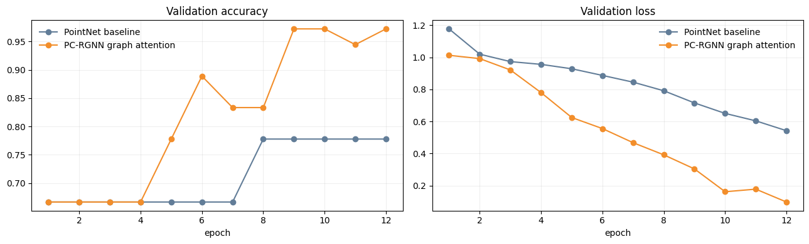
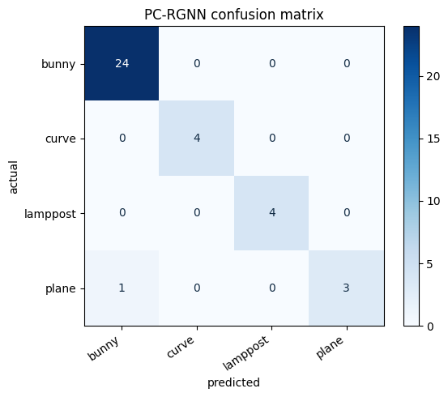
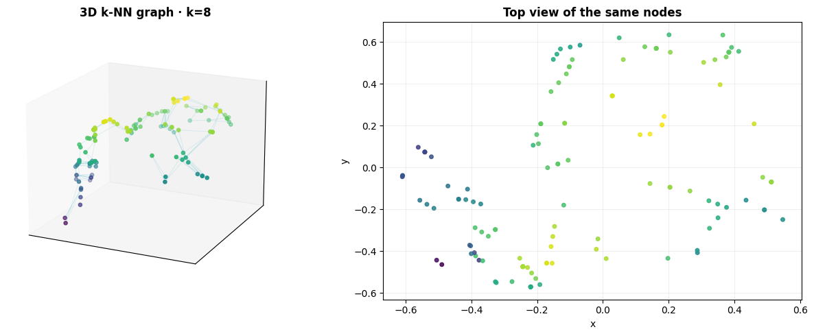
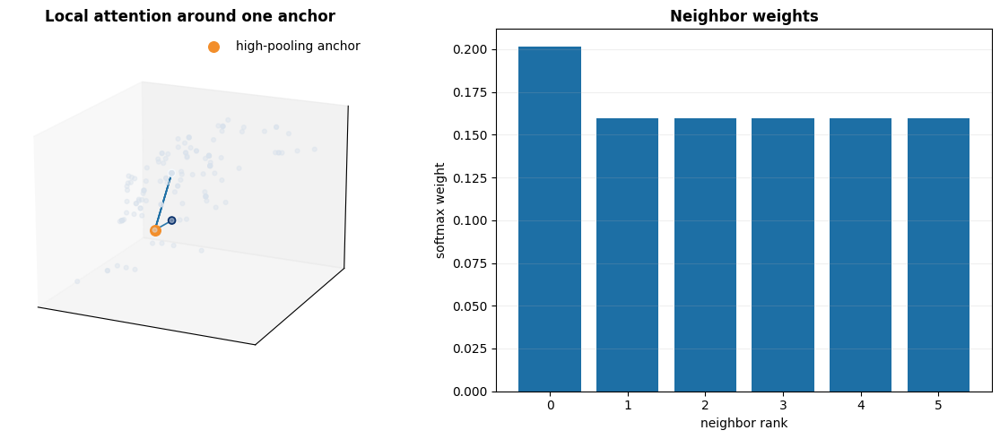
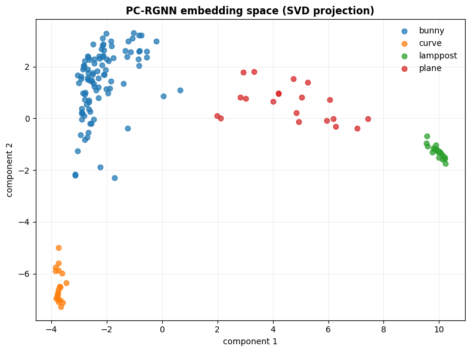

# PC-RGNN project

The primary deliverable is [pc_rgnn_project.ipynb](pc_rgnn_project.ipynb), a real data-science notebook based on the supplied PC-RGNN deck.

It downloads public point-cloud files from the Point Cloud Library test corpus, performs data-quality inspection and visualization, simulates sparse LiDAR observations, applies graph-aware completion, trains a PointNet baseline and an attention-based multi-scale graph model, and reports metrics plus attention visualizations.

## Run the notebook

```bash
python3 -m venv .venv
source .venv/bin/activate
pip install -r requirements.txt
jupyter lab
```

Open `pc_rgnn_project.ipynb` and run all cells. The first notebook cell also installs the required packages when run interactively.

## Scope

This is an executable research prototype. The source point-cloud corpus is intentionally compact, so the notebook includes explicit limitations and does not present its small validation result as a benchmark claim. Extending it to KITTI or nuScenes with box annotations is the next step for true 3D detection training.

## Verified notebook results

The notebook was executed successfully with no cell errors. It loaded 8 real PCD files and generated 160 augmented examples across 4 classes.

The final validation accuracy was:

- PointNet baseline: `0.778`
- PC-RGNN graph attention: `0.972`
- PC-RGNN classification report accuracy: `0.97`

The confusion matrix contains one plane sample classified as bunny; curve and lamppost are classified correctly in the recorded validation split. Because the corpus is small and augmentation-based, these numbers are a pipeline check rather than a generalization benchmark.

## Visualizations

### Raw point-cloud inventory


### Graph completion


### Training curves



### Confusion matrix



### k-NN graph structure



### Learned attention



### Learned embedding space


