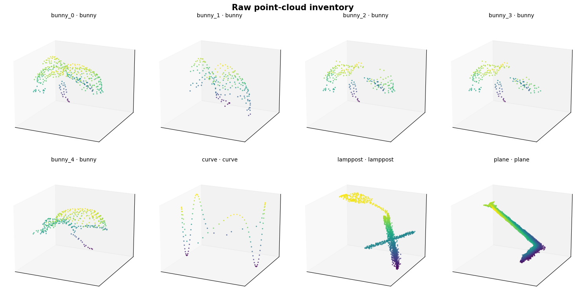
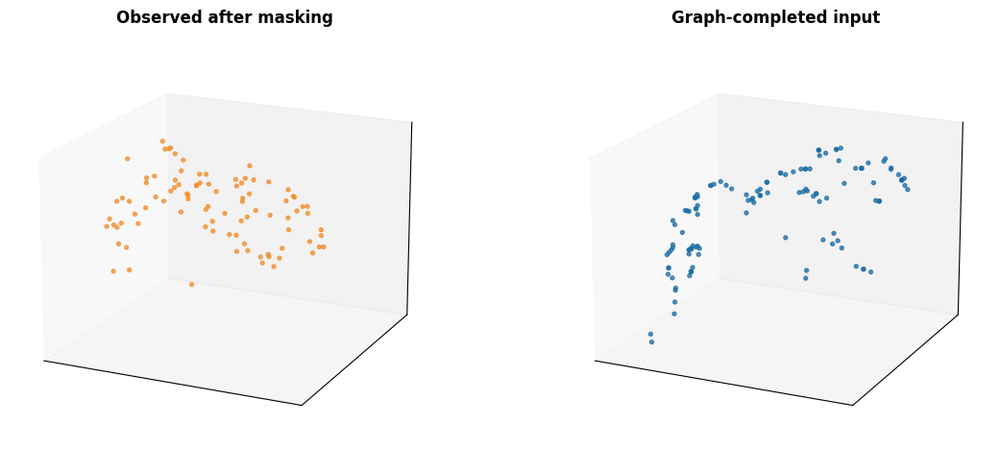
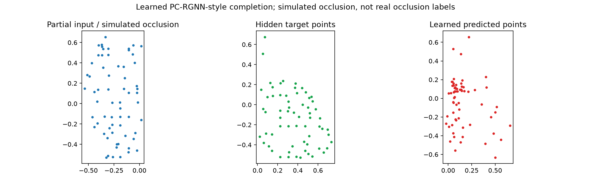

# PCRGNN

## Overview

PC-RGNN is a notebook-first point-cloud learning project built around PyTorch graph neural networks and multi-scale attention. The end-to-end path takes a partial point cloud, predicts missing points, builds features from the observed-plus-completed cloud, and feeds those features to detection heads. It contains a reproducible PCL demonstration and a separate nuScenes mini object-level detection track, with dataset provenance, integrity checks, scene-aware validation, and explicit evaluation limitations.

## Project scope

This repository contains two explicitly separated, notebook-first tracks:

1. [pc_rgnn_pcl_integrity_demo.ipynb](pc_rgnn_pcl_integrity_demo.ipynb) verifies eight real public PCL test-corpus files and trains a small self-supervised completion decoder on simulated one-sided masks before building graph-attention features. Its derived views and synthetic targets retain source identifiers. Because the manually assigned filename labels do not provide a class-balanced source-aware holdout, it reports no classification accuracy.
2. [nuscenes_mini_pcrgnn_detection.ipynb](nuscenes_mini_pcrgnn_detection.ipynb) is a real annotated-data development track for the official nuScenes mini split. It loads local LiDAR and boxes through the official devkit, simulates a held-out partial crop, predicts missing points, builds completion-aware graph features, and reports center, size, yaw, axis-aligned 3D IoU, precision, recall, and per-class diagnostics.

The static frontend was removed so the notebooks and audit artifacts are the primary project surface.

## Integrity status

The eight local PCD files are pinned to PCL revision 66e1d0ea8cc3fa54820eb38e18ad0adac6345b94. The manifest records each upstream URL, byte count, and SHA-256 digest:

- [data/pc_rgnn/provenance.json](data/pc_rgnn/provenance.json)
- [docs/DATA_CARD.md](docs/DATA_CARD.md)
- [verify_integrity.py](verify_integrity.py)

Run the local and remote verification:

~~~bash
python verify_integrity.py --online
~~~

The PCL filenames are used as manual project labels, not official benchmark annotations. Raw files, derived normalized/subsampled views, and synthetic completion points are described separately. The former augmented-copy validation score is not presented as trustworthy generalization evidence.

## nuScenes mini detection track

Download v1.0-mini through the official nuScenes distribution and keep the raw dataset outside Git. Then install dependencies and point the notebook at it:

~~~bash
pip install -r requirements.txt
export NUSCENES_ROOT=/path/to/nuscenes
~~~

The notebook uses official scene, category, pose, LiDAR, and box tables. It enforces a scene-disjoint train/validation split and performs an object-level development experiment from ground-truth-centered crops. Results are mini-split development diagnostics, not full-dataset leaderboard claims. The reported IoU is axis-aligned diagnostic IoU rather than official oriented nuScenes AP.

If nuScenes is not mounted, the notebook skips data-dependent cells with setup instructions instead of fabricating results.

## Reproducible PCL plots

The following figures are regenerated by `pc_rgnn_pcl_integrity_demo.ipynb` and describe raw/derived/synthetic data explicitly:

## Repository map

- pc_rgnn_pcl_integrity_demo.ipynb — reproducible public-data integrity and graph/attention demonstration.
- nuscenes_mini_pcrgnn_detection.ipynb — external-data, scene-disjoint detection development notebook.
- data/pc_rgnn/provenance.json — pinned PCL source manifest.
- docs/DATA_CARD.md — provenance, labels, split, and limitation policy.
- verify_integrity.py — local and online source/hash/PCD validation.

## Scope and limitations

This project is intentionally honest about evidence boundaries. PCL supplies eight real source files, not 160 independent scans, and its completion supervision is simulated masking rather than real occlusion ground truth. Augmentation cannot increase the number of independent sources. The nuScenes notebook is a compact object-level detector with a completion-aware feature path; it does not replace a full-scene proposal pipeline or official benchmark evaluation.
